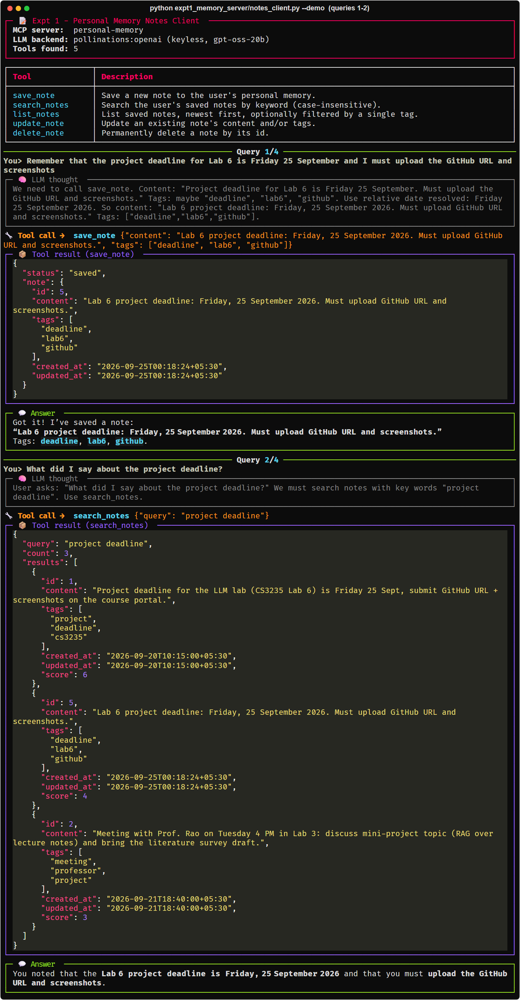
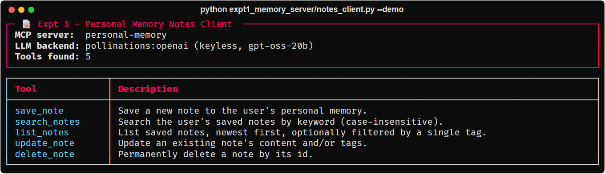
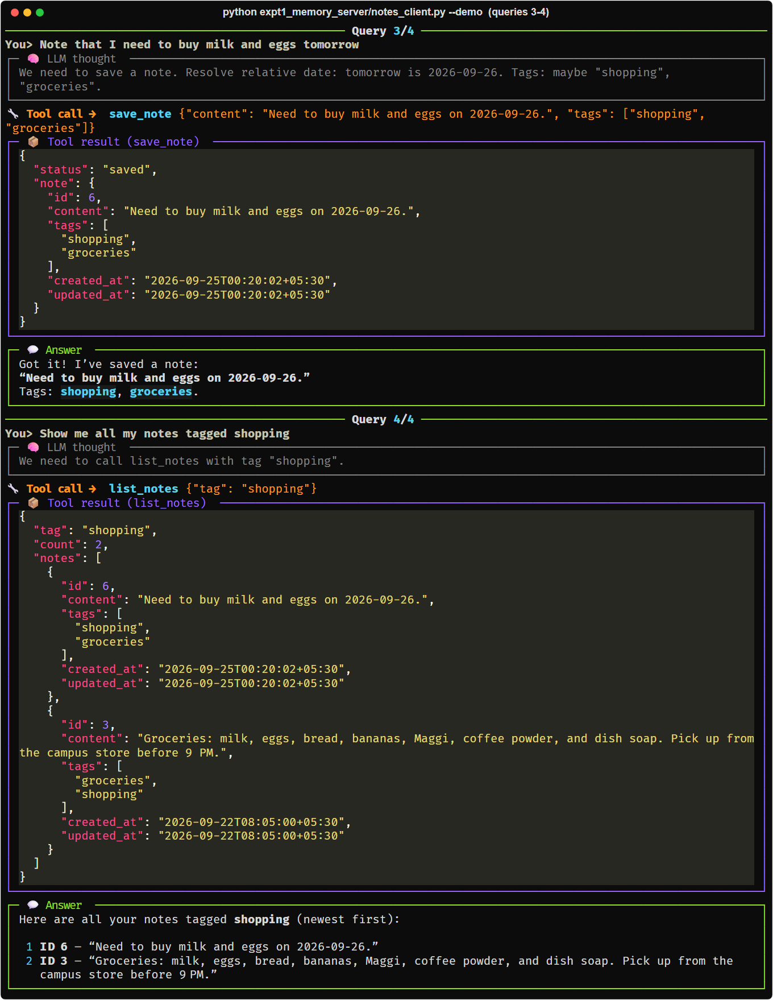
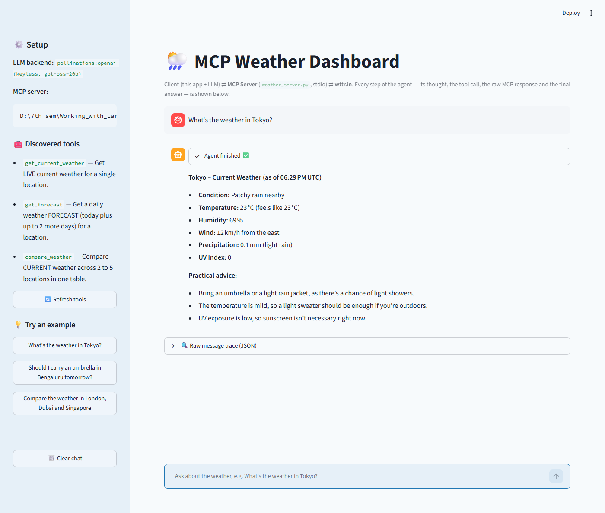
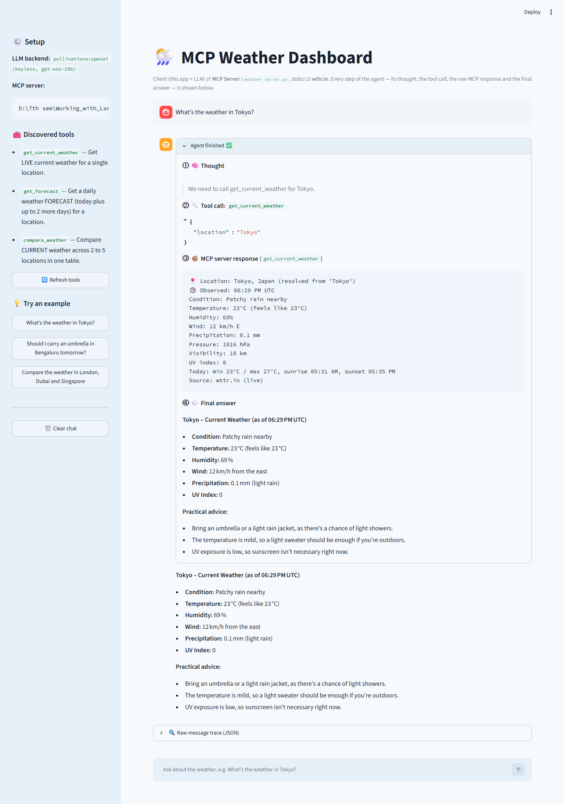
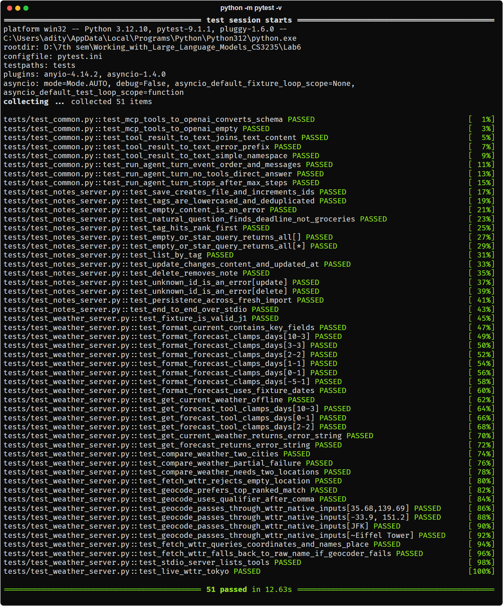
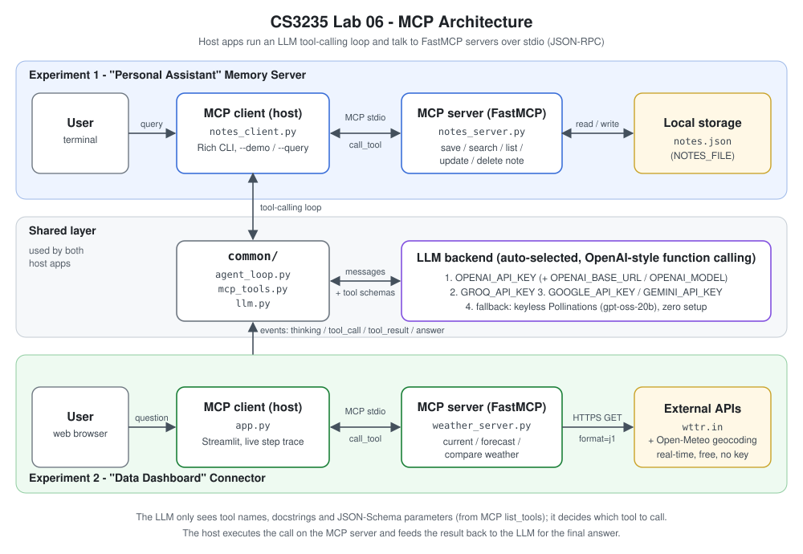

# CS3235 Lab 06: LLMs for Code Generation & Software Development (MCP)

Two Model Context Protocol (MCP) projects. **Experiment 1** is a personal memory server with CRUD tools, used from a CLI chat client. **Experiment 2** is a live weather connector with a Streamlit dashboard that shows each step of how the LLM decides to call tools.

**Part A** ([`partA_ai_coding/`](partA_ai_coding/)) covers the lab-manual tasks: code generation, debugging, refactoring, documentation and a comparison of two AI coding assistants (Claude Code and ChatGPT / OpenAI gpt-oss-20b) on a student marks program. See [Part A: AI coding assistants](#part-a-ai-coding-assistants).

| | |
|---|---|
| **Course** | CS3235 Working with Large Language Models |
| **Lab** | 06: LLMs for Code Generation & Software Development |
| **Student** | Aditya Kumar (1RVU23CSE029) |
| **Stack** | Python 3.10+, MCP Python SDK v1 (`mcp[cli]`, FastMCP), Streamlit, Rich, httpx, pytest |

---

## Screenshots

| Expt 1: CLI demo | Expt 1: tools discovered from the MCP server |
|---|---|
|  |  |

| Expt 1: CLI demo (queries 3-4) |
|---|
|  |

| Expt 2: dashboard answering "What's the weather in Tokyo?" | Expt 2: live agent steps |
|---|---|
|  |  |

| Test suite |
|---|
|  |

---

## Architecture



Each host app (CLI or Streamlit) starts its MCP server as a subprocess and talks to it over **stdio (JSON-RPC)**. It gives the server's tool schemas to an LLM and runs a **tool-calling loop**: the LLM requests a tool, the host runs it on the MCP server, and the result goes back to the LLM. [`docs/architecture.md`](docs/architecture.md) has a sequence diagram for one request in each experiment.

## What is MCP?

The **Model Context Protocol** is an open standard for connecting LLM applications to external tools and data. An **MCP server** exposes *tools* (functions), *resources* and *prompts*, each with a name, a description and a JSON-Schema input. An **MCP client** inside a host application (Claude Desktop, an IDE, or our own CLI/web app) discovers these with `tools/list` and invokes them with `tools/call`. Any MCP-compatible app can reuse the server, so one server replaces many one-off integrations. In this lab the servers are built with **FastMCP**, which generates the schemas from Python type hints and docstrings.

---

## Repository structure

```
Lab6/
├── README.md
├── requirements.txt
├── pytest.ini
├── .env.example                 # optional LLM keys (none are required)
├── .streamlit/config.toml       # Streamlit theme/settings
├── common/                      # shared by both experiments
│   ├── llm.py                   # LLMClient: OpenAI / Groq / Gemini / keyless Pollinations
│   ├── mcp_tools.py             # MCP tool schema -> OpenAI function-calling schema
│   └── agent_loop.py            # tool-calling loop (thinking/tool_call/tool_result/answer events)
├── expt1_memory_server/
│   ├── notes_server.py          # FastMCP server: save/search/list/update/delete notes
│   ├── notes_client.py          # Rich CLI MCP client + LLM tool calling
│   └── notes.json               # note storage (override with NOTES_FILE)
├── expt2_weather_dashboard/
│   ├── weather_server.py        # FastMCP server wrapping wttr.in (+ Open-Meteo geocoding)
│   └── app.py                   # Streamlit dashboard MCP client
├── tests/                       # pytest suite (live network tests marked `live`)
├── docs/
│   ├── architecture.md          # request sequence diagrams
│   ├── architecture.svg         # architecture diagram
│   └── architecture.png         # same diagram as PNG (used in the report)
├── screenshots/                 # submission screenshots
├── partA_ai_coding/             # Part A: AI coding assistants (lab manual subtasks 1-5)
│   ├── prompts.py               # the five prompts from the lab manual
│   ├── ask_chatgpt.py           # sends the prompts to OpenAI gpt-oss-20b, saves the answers
│   ├── run_all.py               # extracts and runs the code from every answer
│   ├── render.py                # renders responses and outputs as PNG images
│   ├── responses/               # raw answers from Claude Code and ChatGPT
│   ├── code/                    # code extracted from the answers
│   ├── outputs/                 # console output of every program
│   └── images/                  # rendered screenshots
└── build_report.py              # builds the Word lab report from the files above
```

---

## Setup

Requires **Python 3.10+**.

**Windows (PowerShell)**

```powershell
cd Lab6
python -m venv .venv
.venv\Scripts\Activate.ps1
pip install -r requirements.txt
```

**macOS / Linux**

```bash
cd Lab6
python3 -m venv .venv
source .venv/bin/activate
pip install -r requirements.txt
```

No API key is needed. See [LLM backends and the keyless fallback](#llm-backends-and-the-keyless-fallback) for how to use your own key.

---

## Experiment 1: "Personal Assistant" Memory Server

**Objective:** build a basic MCP server with CRUD tools and let an LLM decide which tool to call.

### Run

```bash
# Interactive chat (type 'exit' or 'quit' to stop)
python expt1_memory_server/notes_client.py

# Scripted demo: saves notes, then recalls them
python expt1_memory_server/notes_client.py --demo

# One or more one-shot queries (repeatable)
python expt1_memory_server/notes_client.py --query "Remember that the project deadline is Friday" --query "What did I say about the project deadline?"

# Use a separate notes file
python expt1_memory_server/notes_client.py --demo --notes-file my_notes.json
```

These commands are the same on Windows and macOS/Linux, with the venv active. On Windows you can also write the path as `expt1_memory_server\notes_client.py`.

### Sample interaction

A real `--demo` run with the keyless backend (`gpt-oss-20b`), trimmed. Tool results are shortened with `...`; the CLI shows them in full as highlighted JSON.

```
──────────────────────────── Query 1/4 ────────────────────────────
You> Remember that the project deadline for Lab 6 is Friday 25 September and I must upload the
GitHub URL and screenshots
┌─ 🧠 LLM thought ───────────────────────────────────────────────────┐
│ We need to call save_note. ... Tags: ["deadline","lab6","github"]. │
└────────────────────────────────────────────────────────────────────┘
🔧 Tool call → save_note {"content": "Lab 6 project deadline: Friday, 25 September 2026. Must
upload GitHub URL and screenshots.", "tags": ["deadline", "lab6", "github"]}
┌─ 📦 Tool result (save_note) ───────────────────────────────────────┐
│ {"status": "saved", "note": {"id": 5, "content": "Lab 6 project    │
│  deadline: Friday, 25 September 2026. ...", "tags": [...], ...}}   │
└────────────────────────────────────────────────────────────────────┘
┌─ 💬 Answer ────────────────────────────────────────────────────────┐
│ Got it! I've saved a note:                                         │
│ "Lab 6 project deadline: Friday, 25 September 2026. Must upload    │
│ GitHub URL and screenshots."                                       │
│ Tags: deadline, lab6, github.                                      │
└────────────────────────────────────────────────────────────────────┘
──────────────────────────── Query 2/4 ────────────────────────────
You> What did I say about the project deadline?
┌─ 🧠 LLM thought ───────────────────────────────────────────────────┐
│ User asks: "What did I say about the project deadline?" We must    │
│ search notes.                                                      │
└────────────────────────────────────────────────────────────────────┘
🔧 Tool call → search_notes {"query": "project deadline"}
┌─ 📦 Tool result (search_notes) ────────────────────────────────────┐
│ {"query": "project deadline", "count": 3, "results": [             │
│   {"id": 1, "content": "Project deadline for the LLM lab ...",     │
│    "score": 6, ...},                                               │
│   {"id": 5, "content": "Lab 6 project deadline: ...", "score": 4}, │
│   {"id": 2, "content": "Meeting with Prof. Rao ...", "score": 3}]} │
└────────────────────────────────────────────────────────────────────┘
┌─ 💬 Answer ────────────────────────────────────────────────────────┐
│ You noted that the Lab 6 project deadline is Friday, 25 September  │
│ 2026 and that you must upload the GitHub URL and screenshots.      │
└────────────────────────────────────────────────────────────────────┘
──────────────────────────── Query 3/4 ────────────────────────────
You> Note that I need to buy milk and eggs tomorrow
┌─ 🧠 LLM thought ───────────────────────────────────────────────────┐
│ We need to save a note. Resolve relative date: tomorrow is         │
│ 2026-09-26. Tags: maybe "shopping", "groceries".                   │
└────────────────────────────────────────────────────────────────────┘
🔧 Tool call → save_note {"content": "Need to buy milk and eggs on 26 September 2026.", "tags":
["shopping", "groceries"]}
...
──────────────────────────── Query 4/4 ────────────────────────────
You> Show me all my notes tagged shopping
🔧 Tool call → list_notes {"tag": "shopping"}
...
┌─ 💬 Answer ────────────────────────────────────────────────────────┐
│ Here are your shopping-tagged notes (newest first):                │
│  1 Need to buy milk and eggs on 26 September 2026.                 │
│  2 Groceries: milk, eggs, bread, bananas, Maggi, coffee powder,    │
│    and dish soap. Pick up from the campus store before 9 PM.       │
└────────────────────────────────────────────────────────────────────┘
```

The wording changes from run to run, but the tool choice does not: statements go to `save_note`, questions go to `search_notes`, and "tagged X" goes to `list_notes`. A question with no matching note (for example *"What's my wifi password?"*) still calls `search_notes` first, and the assistant then says it has no note about it.

The servers log only warnings and errors to stderr, so their logs do not mix with the client output. Set `LOG_LEVEL=INFO` to see every request.

If the LLM cannot be reached, the client says so and switches to a **labelled rule-based router**. The router sends messages that start with "remember / note (that) / save / add" (and are not questions) to `save_note` with inferred tags, "... tagged X" to `list_notes`, and everything else to `search_notes`, so the MCP side still works without an LLM.

---

## Experiment 2: "Data Dashboard" Connector

**Objective:** connect an AI to an external real-time API (wttr.in) through MCP and have it summarise the live data (context enhancement).

### Run

```bash
streamlit run expt2_weather_dashboard/app.py
```

The same command works on Windows and macOS/Linux. It opens `http://localhost:8501`. Type a question such as *"What's the weather in Tokyo?"* in the chat box.

### Sample interaction

A real run of the dashboard (captured headless with Streamlit's `AppTest`, keyless backend). The four numbered steps appear live inside the assistant message:

> **User:** What's the weather in Tokyo?
>
> **① 🧠 Thought**
> > We need to call get_current_weather for Tokyo.
>
> **② 🔧 Tool call: `get_current_weather`** `{"location": "Tokyo"}`
>
> **③ 📦 MCP server response** (`get_current_weather`)
> ```text
> 📍 Location: Tokyo, Japan (resolved from 'Tokyo')
> 🕒 Observed: 06:29 PM UTC
> Condition: Patchy rain nearby
> Temperature: 23°C (feels like 23°C)
> Humidity: 69%
> Wind: 12 km/h E
> Precipitation: 0.1 mm
> Pressure: 1016 hPa
> Visibility: 10 km
> UV index: 0
> Today: min 23°C / max 27°C, sunrise 05:31 AM, sunset 05:35 PM
> Source: wttr.in (live)
> ```
>
> **④ 💬 Final answer**
>
> **Tokyo – Current Weather (as of 06:29 PM UTC)**
> - **Condition:** Patchy rain nearby
> - **Temperature:** 23 °C (feels like 23 °C)
> - **Humidity:** 69 %
> - **Wind:** 12 km/h from the east
>
> **Practical advice:** Bring an umbrella or a light rain jacket, as there's a chance of light showers. The temperature is mild, so a light sweater should be enough if you're outdoors.

**Place names.** wttr.in's own place lookup is unreliable: `wttr.in/Tokyo` returns the island Shikinejima (min/max 25/25 °C), and `wttr.in/Rome` returns Lome in Togo. So the server first geocodes the name with the free, keyless [Open-Meteo geocoding API](https://open-meteo.com/en/docs/geocoding-api), which ranks matches by population, and then asks wttr.in for those coordinates. You can add a country or region after a comma (`"London, Ontario"`). Coordinates (`"35.68,139.69"`), airport codes (`"JFK"`) and wttr.in's `~place` syntax go to wttr.in unchanged. If the geocoder is down, the server falls back to the plain wttr.in lookup.

Other queries to try: *"Will it rain in London in the next 3 days?"* (`get_forecast`) and *"Compare Delhi, Mumbai and Bengaluru"* (`compare_weather`). An expander shows the **raw JSON message trace**: the exact OpenAI-format messages exchanged, including the `tool_calls` and `tool` results.

---

## How the LLM decides which tool to call

1. **Discovery:** the client calls MCP `list_tools`. FastMCP builds each tool's schema from the Python signature (types become JSON Schema) and its **docstring** (which becomes the description).
2. **Translation:** `common/mcp_tools.py` converts every MCP tool into an OpenAI function-calling definition: `{"type": "function", "function": {name, description, parameters}}`.
3. **Function calling:** the conversation and the tool definitions go to the LLM. The model compares the user's intent with the descriptions. For example, *"Use this whenever the user asks you to remember..."* points it to `save_note`, while a recall question points it to `search_notes`. The model then returns a structured `tool_calls` entry with JSON arguments.
4. **Execution loop:** `common/agent_loop.py` runs the call through the MCP session, appends the result as a `tool` message and asks the LLM again. It repeats until the LLM answers in plain text. Each step is emitted as an event (`thinking`, `tool_call`, `tool_result`, `answer`), which the CLI and the dashboard render.

Good docstrings matter because they are the only guidance the model has for choosing a tool.

---

## Tool reference

### Experiment 1: `notes_server.py`

| Tool | Parameters | Description |
|------|------------|-------------|
| `save_note` | `content: str`, `tags: list[str] \| None` | Save a new note. Tags are lower-cased and de-duplicated. Returns the saved note with its id. |
| `search_notes` | `query: str` | Keyword search over note content and tags. Returns matching notes, best match first. |
| `list_notes` | `tag: str \| None` | List all notes, newest first, optionally filtered by tag. |
| `update_note` | `note_id: int`, `content: str \| None`, `tags: list[str] \| None` | Update the text and/or tags of an existing note. |
| `delete_note` | `note_id: int` | Delete a note by id. |

Notes are stored in `expt1_memory_server/notes.json`. Set the `NOTES_FILE` environment variable (or use `--notes-file` in the client) to point to another file.

### Experiment 2: `weather_server.py`

| Tool | Parameters | Description |
|------|------------|-------------|
| `get_current_weather` | `location: str` | Current conditions: resolved place, temperature, feels-like, condition, humidity, wind, today's min/max and more. |
| `get_forecast` | `location: str`, `days: int = 3` | Daily forecast for 1-3 days (clamped): min/max °C, condition, chance of rain. |
| `compare_weather` | `locations: list[str]` | Markdown table comparing the current weather of 2-5 locations. |

Data comes from `https://wttr.in/<lat>,<lon>?format=j1`, after the place name is geocoded with Open-Meteo (both free, no key). Failures are returned as text that starts with `ERROR:`, so the LLM can explain them instead of crashing.

---

## Testing

```bash
python -m pytest -v                 # full suite
python -m pytest -v -m "not live"   # skip tests that call the real wttr.in API
python -m pytest -v -m live         # only the live network test
```

The tests cover the notes server CRUD tools (using a temporary `NOTES_FILE`), the weather-data formatting (using a recorded wttr.in fixture), geocoding and `fetch_wttr` (with the HTTP calls mocked), and the shared schema-conversion and agent-loop code. The `live` test is skipped automatically when the machine is offline.

---

## Optional: use the servers from MCP Inspector or Claude Desktop

**MCP Inspector** is a web UI for listing and calling tools by hand, and it is installed with `mcp[cli]`:

```bash
mcp dev expt1_memory_server/notes_server.py
mcp dev expt2_weather_dashboard/weather_server.py
```

**Claude Desktop:** add the servers to `claude_desktop_config.json`. On Windows this is `%APPDATA%\Claude\claude_desktop_config.json`. On macOS it is `~/Library/Application Support/Claude/claude_desktop_config.json`. Use absolute paths and the venv's Python:

```json
{
  "mcpServers": {
    "notes": {
      "command": "D:\\path\\to\\Lab6\\.venv\\Scripts\\python.exe",
      "args": ["D:\\path\\to\\Lab6\\expt1_memory_server\\notes_server.py"],
      "env": { "NOTES_FILE": "D:\\path\\to\\Lab6\\expt1_memory_server\\notes.json" }
    },
    "weather": {
      "command": "D:\\path\\to\\Lab6\\.venv\\Scripts\\python.exe",
      "args": ["D:\\path\\to\\Lab6\\expt2_weather_dashboard\\weather_server.py"]
    }
  }
}
```

On macOS/Linux, use `/path/to/Lab6/.venv/bin/python` and forward-slash paths. Restart Claude Desktop, and the tools will appear in the tools menu. With that, the same servers work with a different host and a different LLM, without code changes.

---

## LLM backends and the keyless fallback

`common/llm.py` selects the first backend whose environment variables are set:

| Priority | Environment variables | Backend |
|---|---|---|
| 1 | `OPENAI_API_KEY` (+ optional `OPENAI_BASE_URL`, `OPENAI_MODEL`) | OpenAI or any OpenAI-compatible server (Ollama, LM Studio, OpenRouter, ...) |
| 2 | `GROQ_API_KEY` | Groq |
| 3 | `GOOGLE_API_KEY` or `GEMINI_API_KEY` | Google Gemini (OpenAI-compatible endpoint) |
| 4 | *(none)* | **Pollinations keyless endpoint (`gpt-oss-20b`)**, free and with zero setup |

The lab therefore runs as soon as it is cloned. The keyless endpoint is a free community service, so it can be slow or rate-limited. For reliable results, set a key. [`.env.example`](.env.example) lists the variables. Set them in your shell:

```powershell
$env:GROQ_API_KEY = "gsk_..."        # Windows PowerShell
```
```bash
export GROQ_API_KEY="gsk_..."        # macOS / Linux
```

---

## Learning outcomes and observations

- **MCP separates tools from models.** The same `notes_server.py` works with our CLI, the MCP Inspector and Claude Desktop, and with any LLM backend, without changes.
- **Docstrings are prompts.** Tool selection depends mostly on the tool descriptions. Clear "use this when..." wording noticeably improved the choice between `save_note` and `search_notes`, and between `get_current_weather` and `compare_weather`.
- **Function calling is structured output.** The LLM does not run anything. It emits a JSON request, and the host validates it and executes it. This keeps side effects under the application's control.
- **Context enhancement.** Experiment 2 grounds the answer in live data. The server condenses the large wttr.in JSON response into a few lines of text, so the answer is accurate and uses few tokens. Without the tool, the model can only guess.
- **Robustness matters.** Tools return `ERROR:` strings instead of raising, the LLM client retries, and the CLI falls back to a rule-based router. Together these keep the demo working when the network or the LLM is unreliable.
- **Observability helps understanding.** Showing each thought, tool call, server response and answer (plus the raw message trace) makes the agent loop clear and easy to debug.

---

## Use of AI coding assistants

This lab was built with **Claude Code** (Anthropic's AI coding assistant), in line with the lab's theme of LLMs for software development. It was used for:

- **Code generation:** the MCP servers, clients, shared LLM/agent-loop modules and the Streamlit UI.
- **Test generation:** the pytest suite, including offline fixtures for the weather API.
- **Debugging:** diagnosing MCP stdio and async issues and tool-calling edge cases across LLM backends.
- **Documentation:** this README, the architecture notes and the diagram.

All generated code was reviewed, run and tested before submission.

---

## Part A: AI coding assistants

The lab manual's Exp 6 asks for the same student-marks tasks to be done with two AI tools and compared. Everything is saved, so the comparison can be re-checked:

```bash
python partA_ai_coding/ask_chatgpt.py   # query OpenAI gpt-oss-20b (keyless) with the 5 prompts
python partA_ai_coding/run_all.py       # run every generated program with the same input
python partA_ai_coding/render.py        # render responses + outputs as images
python build_report.py                  # build the Word report
```

| Subtask | Result |
|---|---|
| 1. Code generation | Both programs give average 59.4, topper Sneha (91), below 40: Rohan, Karan |
| 2. Debugging | Both tools found the bug (looping over dict keys) and the fixed code prints `Average marks: 65.0` |
| 3. Refactoring | Both refactored versions keep the original behaviour (71.5, Vikram, Meena failed) |
| 4. Documentation | Both added docstrings and a README. ChatGPT's README example claims 64.5, but the real value is 61.5 |
| 5. Full program | Both correct. ChatGPT's is menu-driven with input checks (155 lines); Claude's is shorter and simpler (80 lines) |

