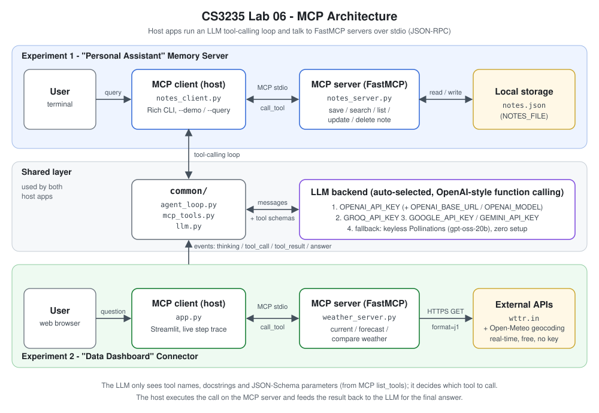
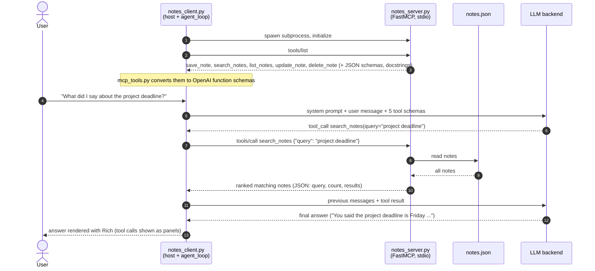
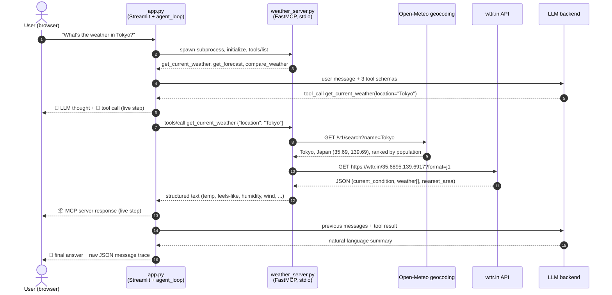

# Architecture

Both experiments use the same three-part pattern:

| Role | Experiment 1 | Experiment 2 |
|------|--------------|--------------|
| **Host / MCP client** (runs the LLM loop) | `expt1_memory_server/notes_client.py` (Rich CLI) | `expt2_weather_dashboard/app.py` (Streamlit) |
| **MCP server** (exposes tools over stdio) | `expt1_memory_server/notes_server.py` | `expt2_weather_dashboard/weather_server.py` |
| **Data source** | local `notes.json` | live `wttr.in` API (`?format=j1`), with place names geocoded by Open-Meteo |

Shared code in `common/`:

- `llm.py`: `LLMClient` picks a backend (OpenAI-compatible, Groq, Gemini, or the keyless Pollinations fallback) and exposes one OpenAI-style chat + tools interface.
- `mcp_tools.py`: converts each MCP `Tool` (name, description = docstring, `inputSchema`) into an OpenAI function-calling schema.
- `agent_loop.py`: the tool-calling loop. It sends messages and tool schemas to the LLM, runs any requested tool through the MCP session, appends the result, and repeats until the LLM gives a final answer. Every step is emitted as an event: `thinking`, `tool_call`, `tool_result`, `answer`.

The host starts the server as a **subprocess** and speaks MCP JSON-RPC over its stdin/stdout (`stdio_client` + `ClientSession`). The LLM never touches the server directly. It only *requests* a tool call and the host executes it.

---

## Experiment 1: one request

Query: *"What did I say about the project deadline?"*

1. The client launches the server and discovers its tools with `list_tools`.
2. The tool list is converted into function-calling schemas. The **docstrings** tell the model when to use each tool (for example, save_note is for "remember ..." and search_notes is for "what did I say ...").
3. The LLM reads the question and returns a `tool_call` instead of text. A statement such as *"Remember that the demo is on Monday"* would produce `save_note` instead.
4. The host executes the call over MCP. The server reads or writes `notes.json` and returns structured text.
5. The result goes back to the LLM as a `tool` message, and the LLM writes the final answer.
6. If the LLM is unreachable, a clearly labelled **rule-based router** picks `save_note` or `search_notes` from keywords (plus list_notes for "... tagged X"), so the CLI still works without an LLM.

---

## Experiment 2: one request

Query: *"What's the weather in Tokyo?"*

1. Streamlit takes the question and starts the agent loop against the weather server.
2. The LLM chooses among the three tools using their docstrings: current conditions, a 1-3 day forecast, or a 2-5 city comparison.
3. Each loop event is rendered **as it happens** as a numbered step (🧠 thought → 🔧 tool call → 📦 server response → 💬 answer). This makes the context-enhancement flow visible.
4. The server first geocodes the place name with Open-Meteo, because wttr.in's own lookup picks odd matches (it resolves "Tokyo" to the island Shikinejima and "Rome" to Lome in Togo). It then fetches **real-time** data for those coordinates from wttr.in and condenses the large JSON into compact, structured text. This keeps the LLM context small and factual.
5. The LLM summarises that data. It never invents weather values because they come from the tool result.
6. An expander shows the raw OpenAI-format message list (system, user, assistant tool_calls, tool results, final assistant message) for inspection.
